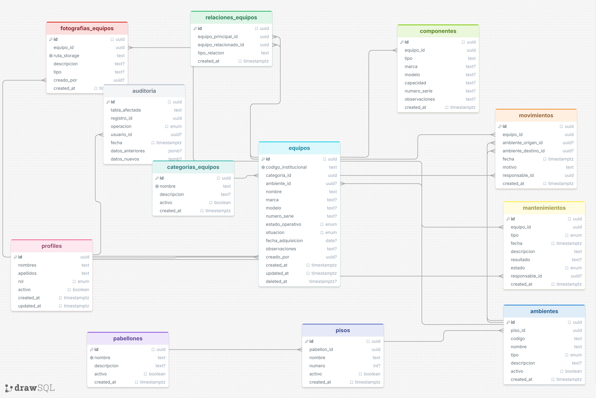

### 5. Generación del diagrama entidad-relación

1. Utilizar DrawSQL para elaborar la representación visual del modelo entidad-relación de la base de datos.
2. Representar las tablas del sistema de inventario, incluyendo sus campos y las relaciones entre las entidades.
3. Identificar las claves primarias (PK), las claves foráneas (FK) y las relaciones que permiten mantener la integridad referencial.
4. Organizar las tablas para facilitar la lectura y comprensión de la estructura de la base de datos.
5. Exportar el diagrama en formato PNG y almacenarlo en `documentacion/base-datos/diagrama-er.png`.
6. Incorporar la imagen en `documentacion/base-datos/05-modelo-entidad-relacion.md`, acompañada de una descripción de la estructura y las relaciones principales.

**Resultado esperado:** diagrama entidad-relación documentado y visualmente organizado, que represente las tablas y relaciones del sistema de inventario institucional.

## Diagrama disponible

La imagen disponible actualmente está en formato JPEG:

## Estructura y relaciones principales

El modelo presenta las tablas del sistema. La jerarquía de ubicaciones se organiza mediante `pabellones`, `pisos` y `ambientes`; los equipos se relacionan con `categorias_equipos` y `ambientes`. `componentes`, `fotografias_equipos`, `mantenimientos` y `movimientos` registran información asociada a cada equipo. `relaciones_equipos` permite asociar equipos entre sí, mientras que `profiles` identifica a los usuarios vinculados a operaciones y registros de auditoría en `auditoria`. `equipos_eliminados` conserva la constancia de las bajas definitivas sin mantener una clave foránea hacia `equipos`, porque el activo ya no existe.

Las claves foráneas documentadas conectan cada registro con su entidad relacionada y preservan la integridad referencial. Consulta [02-relaciones-y-restricciones.md](02-relaciones-y-restricciones.md) para ver el detalle de las columnas relacionadas.

La migración `supabase/migrations/013_cierre_mantenimientos.sql` incorpora además `mantenimiento_cambios_estado`, que no aparece en el diagrama original: registra la transición de estado de cada intervención y del equipo afectado, junto con el motivo, el usuario y la fecha.
